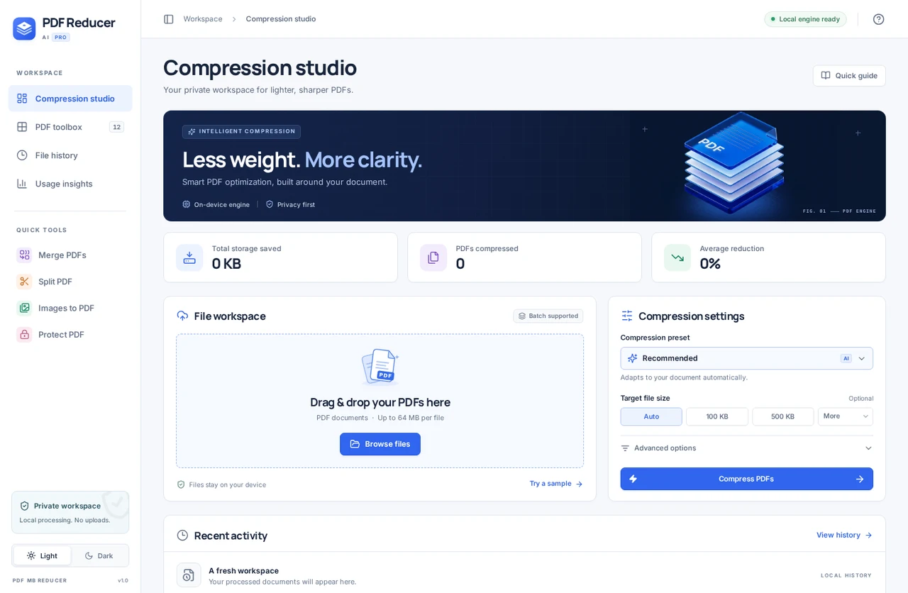

# PDF MB Reducer AI PRO

An Android-first, offline PDF compression studio with a **Kotlin / Jetpack Compose Android host**, a shared responsive workspace, and a real local PDF engine. No account, API key, document upload, backend or paid runtime service is required.



**Browser site:** [PDF Reducer Studio](https://abc07552.github.io/PDF-compreser/) · [Enable GitHub Pages / deployment guide](docs/PAGES.md). The site is available once the repository owner enables `main` → `/docs`.

## Try it in a minute

1. Open **Compression studio** and choose **Try a sample** or **Browse files**.
2. Leave the preset on **Recommended**. The analyzer identifies the document type and shows an estimated size range. Expand **Compare compression profiles** to see different quality/size trade-offs.
3. Select **Compress PDFs**. Choose **Compare** to inspect corresponding pages, then **Download** or **Share** to keep the result.

**A target is a preference, not a guarantee.** The compressor never replaces the original file. If no smaller valid candidate is found, it returns the original bytes and says so. Results must be saved before closing the workspace.

## Get the application

### Android phone

The [beginner Android installation guide](docs/ANDROID.md) covers Android Studio, APK installation, signing a release, and building an AAB. The source archive includes the **prebuilt offline workspace**, so Android Studio can open its `android/` directory directly without installing Node first.

For a fresh Git checkout, prepare the assets and build an installable debug APK:

```sh
# From the repository root. Requires Node.js 22.12+ and npm.
npm ci
npm run android:sync
cd android
./gradlew :app:assembleDebug
```

On Windows, use `gradlew.bat` instead of `./gradlew`. The APK is at `android/app/build/outputs/apk/debug/app-debug.apk`. Android builds require JDK 17, Android SDK platform 36 and Build Tools 35.0.0. The first build needs access to the standard Gradle, Google and Maven repositories. The installed app works offline from its **first launch**.

**Runtime:** Android 10 or later, with Android System WebView / Chrome 143 or later. There is an update explanation instead of a blank screen on unsupported WebViews.

### Browser workspace

```sh
npm ci
npm run dev
```

Open the address printed by Vite. Use a current Chromium browser. For a production build with offline installation:

```sh
npm run build
npm run preview
```

Serve `dist/` at the root or a project subdirectory of an **HTTPS origin** (localhost also works). Open it online once so the service worker can finish caching the bundled engines, fonts and interface. Chrome’s **Install app / Add to home screen** makes the workspace available as an app. The development server intentionally does not install a service worker. Do not deploy the development server or open `index.html` using `file://`.

## What works

| Area | Implementation |
| --- | --- |
| Compression | Recommended, Balanced, High, Extreme and Custom; lossless candidate comparison; image resampling/re-encoding; resource deduplication and structural packing; verified output. |
| Targets | Auto, 100/200/300/500 KB, 1/2 MB, or a custom maximum in KB. Up to two additional image-quality/DPI attempts for an unmet target, optionally disabled. |
| Customization | 72/96/120/150/200/300 DPI; 10–100% JPEG quality; preserve color, grayscale, or black-and-white. Bilevel images use packed 1-bit lossless streams. |
| Smart analysis | Local structural heuristics—not a cloud language model—classify likely text, scanned, image-heavy and mixed files. Preset estimates account for editable image encodings, dimensions and page sizes. |
| Batch experience | Multiple-file picker, drag-and-drop, sequential compression, actual stage progress, cancellation, rerunning, before/after page preview, download and supported system sharing. |
| PDF toolbox | Compress, merge, split to a ZIP, extract page ranges, organize and rotate, PDF to PNG/JPEG/WebP, images to PDF, AES-256 protect, authorized unlock, text watermark, metadata removal and preview. |
| Dashboard | Real original/output bytes, saved bytes and percentage, cumulative savings, recent activity, searchable history, daily/monthly usage and 7/30-day activity charts. No seeded user statistics. |
| Design | Navy/blue studio, self-hosted typography, light/dark themes, responsive phone navigation, tablet/desktop sidebar, keyboard dialogs, reduced-motion support. |
| Privacy | Native system file picker; app-private, bounded export staging; automatic cleanup; no INTERNET permission in Android; SQLite metadata on Android, IndexedDB metadata on the web; history opt-out and erasure. |

## Project map

```text
android/                          Standalone Android Studio / Gradle project
  gradlew, gradlew.bat, gradle/    Pinned Gradle wrapper
  app/src/main/
    AndroidManifest.xml           Offline permissions, activity, scoped FileProvider
    java/app/pdfreducer/studio/
      MainActivity.kt             Compose lifecycle, WebView isolation, SAF picker/export
      ActivityStore.kt            SQLite schema and metadata operations
      Exports.kt                  Bounded chunk writer and WorkManager cleanup
    res/                          Icons, theme, export paths and backup restrictions
    assets/workspace/             Generated local app and engines (included in source ZIP)
  app/src/androidTest/            Native storage, permissions and workflow instrumentation
src/
  App.tsx, main.tsx, styles.css    Navigation, responsive shell, privacy and theme
  components/                     Studio, settings, toolbox, history, analytics, comparison
  engine/
    client.ts, worker.ts           Cancellable worker lifecycle and message protocol
    types.ts                      Limits, settings, ranges, estimates and result types
    document.ts                   Parsing, classification, metadata, safe deduplication
    images.ts, colors.ts           Bounded image optimization and basic vector color modes
    compress.ts                   Candidate selection, target retries, output validation
    qpdf.ts                       Private WASM filesystem and authenticated validation
    tools.ts, render.ts            Document operations, local rendering and image export
  storage.ts, catalog.ts           Persistence/export adapters and tool definitions
public/                           Brand, illustration, manifest, notices, generated assets
scripts/                          Asset assembly, fixtures, offline build and packaging
tests/                           Browser engine/integration tests (not shipped in app)
.github/workflows/verify.yml       Tests, Android build and optional emulator checks
docs/                            Install guide, engine design, privacy and QA results
```

### Reproducible commands

| Command | Result |
| --- | --- |
| `npm run check` | Strict TypeScript and code-format checks. |
| `npm test` | Generates the test corpus, builds the production app, exercises actual browser workers and the offline UI. |
| `npm run pages:build` | Refreshes the prebuilt GitHub Pages site in `docs/`, leaving the installation and verification guides intact. |
| `npm run android:sync` | Rebuilds and copies **all** runtime assets into the native app, with no CDN dependencies. |
| `npm run package:source` | Creates `deliverables/PDF-MB-Reducer-AI-PRO-source.zip` and a SHA-256 checksum, excluding credentials, caches and user documents. |

On Linux x86-64 the tests use a pinned, npm-distributed headless Chromium. On macOS/Windows, run `npx playwright install chromium` once, or set `BROWSER_EXECUTABLE` to a current local Chrome executable. Dependency versions and integrity hashes are recorded in `package-lock.json`.

## Verification and limitations

- [Measured outputs, test coverage and release gates](docs/VERIFICATION.md)
- [Compression algorithm, bounded-memory design and format limitations](docs/ENGINE.md)
- [Privacy, retention, sharing and security model](docs/PRIVACY.md)
- [Dependency licenses and notices](THIRD_PARTY_NOTICES.md)

The web build and PDF processing tests were run in this environment. The Android source, wrapper, instrumentation tests and CI workflow are included; **an Android SDK/emulator was not available here, so no locally verified or signed APK is claimed**. Build, run the native tests and verify a signed release on a device before distribution.
